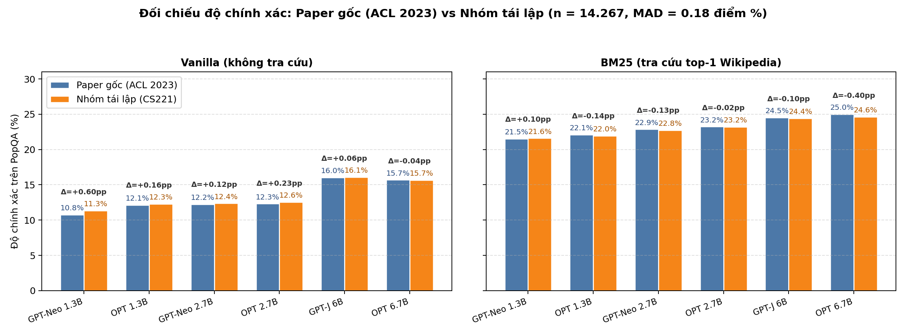
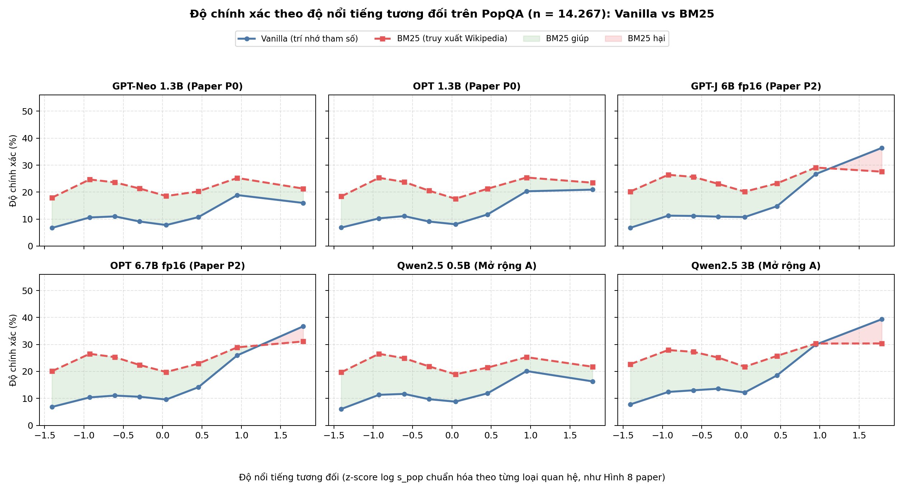
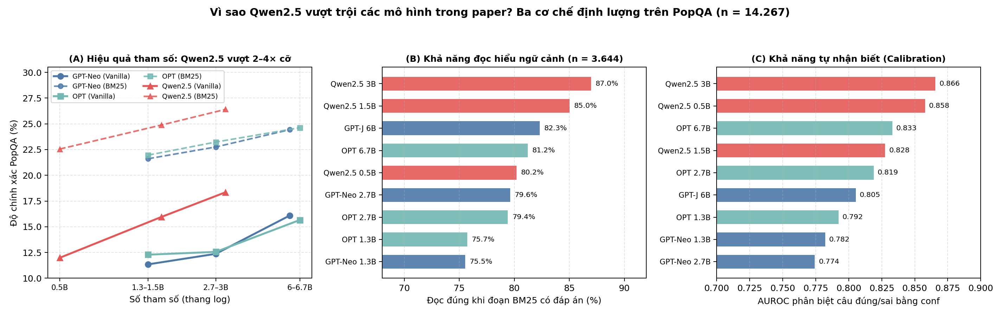

# CS221 · Tái lập và Mở rộng *"When Not to Trust Language Models"* (ACL 2023)

Đồ án cuối kỳ môn **Nhập môn Xử lý ngôn ngữ tự nhiên (CS221, UIT)**. Nhóm tái lập thực nghiệm của bài báo
**[When Not to Trust Language Models: Investigating Effectiveness of Parametric and Non-Parametric Memories](https://aclanthology.org/2023.acl-long.546/)**
(Mallen et al., ACL 2023, Long Paper) trên toàn bộ **14.267 câu hỏi PopQA** (16 loại quan hệ), sau đó mở rộng sang **họ mô hình thế hệ mới (Qwen2.5 0.5B / 1.5B / 3B)**, thử nghiệm **Adaptive Retrieval theo độ tự tin (`conf`)** và tiến hành **4 phân tích chuyên sâu về cơ chế lỗi**.

| Phần | Trọng số | Nội dung thực hiện | Trạng thái |
|---|---:|---|---|
| **Tái lập** | 60% | Cả 6 mô hình gốc (GPT-Neo 1.3B/2.7B, OPT 1.3B/2.7B/6.7B, GPT-J 6B) đều chạy `vanilla`, `BM25`, `Adaptive` đủ 14.267 câu; riêng `GenRead` chỉ chạy trên 2 mô hình 1.3B (`GPT-Neo 1.3B`, `OPT 1.3B`) do rất tốn GPU (~18–25h/mô hình) + đối chiếu số liệu paper | **Hoàn thành (MAD = 0,18 điểm %)** |
| **Mở rộng** | 30% | **Hướng A:** Qwen2.5 base (0.5B, 1.5B, 3B) đủ 14.267 câu + kiểm định giả thiết. **Hướng C:** Adaptive theo độ tự tin (`conf`) thay cho độ nổi tiếng (`s_pop`) | **Hoàn thành** |
| **Phân tích** | 10% | (1) Chấm chặt hơn `is_correct_strict`, (2) 16 loại quan hệ, (3) Retrieval gây hại & đoạn dùng chung (33,6% bộ dữ liệu), (4) Đoạn có đáp án mà vẫn sai | **Hoàn thành** |

- **Slide thuyết trình (22 slides, chuẩn 15 phút):** [Google Slides](https://docs.google.com/presentation/d/1wYAEJkvDLsBqrYge-n0-cyhAbxW94btiLmZKfEOzhB0/edit) · Bản PowerPoint xuất sẵn: [`slides/CS221_Adaptive_Retrieval.pptx`](slides/CS221_Adaptive_Retrieval.pptx)

---

## Mục lục

1. [Cấu trúc thư mục](#1-cấu-trúc-thư-mục)
2. [Hướng dẫn chạy lại & kiểm chứng số liệu (dành cho giảng viên / người đánh giá)](#2-hướng-dẫn-chạy-lại--kiểm-chứng-số-liệu)
3. [Đối chiếu số liệu: Paper gốc (ACL 2023) vs Nhóm tái lập](#3-đối-chiếu-số-liệu-paper-gốc-acl-2023-vs-nhóm-tái-lập)
4. [Phân tích cải tiến: Qwen2.5 có tốt hơn mô hình trong paper không và tại sao? (kèm kiểm định thống kê)](#4-phân-tích-cải-tiến-qwen25-có-tốt-hơn-không-và-tại-sao)
5. [Tóm tắt hướng phụ C (Adaptive theo độ tự tin) và 4 phân tích lỗi (10%)](#5-tóm-tắt-hướng-phụ-c-và-4-phân-tích-chuyên-sâu-10)
6. [Phạm vi không tái lập được & Nguồn tham khảo](#6-phạm-vi-không-tái-lập-được--nguồn-tham-khảo)

---

## 1. Cấu trúc thư mục

```text
.
├── requirements.txt          # Thư viện Python cần cài để tái tạo toàn bộ bảng, hình và test trên CPU
├── upstream/                 # Code gốc của tác giả (commit 8172ab0, chỉ đọc để đối chứng) + popQA.tsv (14.267 câu)
│   └── KNOWN_ISSUES.md       # 10 lỗi đã xác minh trong code gốc của tác giả
├── data/
│   ├── README.md             # Nguồn tải dữ liệu PopQA & file BM25 (42 MB, nằm trên Kaggle Dataset)
│   └── subset_300_ids.txt    # 300 ID cố định (seed 633) dùng để smoke test và đối chứng code gốc
├── notebooks/                # Notebook chạy GPU Kaggle/Colab (xem bảng phân loại bên dưới)
├── scripts/                  # Toàn bộ script CPU: rút gọn, gộp adaptive, kiểm định thống kê, vẽ hình & unit test
│   └── run_all_tests.py      # Chạy toàn bộ 9 bộ kiểm thử tự động chỉ bằng 1 lệnh
├── results/
│   ├── slim/                 # 40 file CSV kết quả rút gọn (9 mô hình × 300 & 14.267 câu, có cả is_correct_strict & conf)
│   ├── code_goc/             # Kết quả chạy nguyên bản run_model.py (GPT-Neo 1.3B/2.7B) để đối chứng
│   ├── tables/               # Toàn bộ bảng CSV tổng hợp và kết quả kiểm định thống kê
│   ├── figs/                 # Các biểu đồ PNG dùng cho báo cáo và slide
│   └── RUNS.md               # Nhật ký chi tiết mọi phiên chạy GPU (mô hình, GPU, thời gian, link Kaggle)
├── slides/
│   └── CS221_Adaptive_Retrieval.pptx  # Bản PowerPoint (22 slides) xuất trực tiếp từ Google Slides của nhóm
└── docs/
    ├── paper_numbers.csv     # Số liệu trích từ biểu đồ vector PDF của paper gốc (Hình 7, 9, 10, 13)
    ├── BANG_TAI_LAP.md       # Bảng tái lập so với paper, 4 kết luận, và bảng 2×2 retrieval giúp/hại
    ├── BANG_MO_RONG.md       # Kết quả chi tiết Hướng C (Adaptive theo độ tự tin)
    ├── PHAN_TICH.md          # 4 phân tích chuyên sâu (10%) kèm ví dụ thật
    ├── KHAC_BIET.md          # Toàn bộ 13 điểm khác biệt kỹ thuật so với paper/code gốc
    ├── QUYET_DINH.md         # Nhật ký các quyết định thiết kế thực nghiệm
    └── KE_HOACH.md           # Kế hoạch thực hiện đồ án
```

### Phân loại nhanh các notebook trong `notebooks/`

| Mục đích | File nên mở | Ghi chú |
|---|---|---|
| **Chạy lại pipeline chuẩn cho mô hình bất kỳ** | [`notebooks/adaptive_retrieval_repro.ipynb`](notebooks/adaptive_retrieval_repro.ipynb) (bản text: `.py`) | Hỗ trợ HF local (fp32/fp16/4-bit), smoke test 300 câu, auto-resume, tính adaptive & vẽ hình |
| **Chạy đối chứng nguyên bản code tác giả** | [`notebooks/upstream_kaggle.ipynb`](notebooks/upstream_kaggle.ipynb) | Chạy `upstream/run_model.py` không chỉnh sửa trên 300 câu, tự kiểm khớp `subset_300_ids.txt` |
| **Chạy lại đúng cấu hình 14.267 câu (có `conf`)** | `gpt_neo_vanilla_opt_1_3b.ipynb`, `qwen2_5_0_5b_1_5b.ipynb`, `opt_6_7b_fp16.ipynb` | Chạy song song 2 GPU T4 trên Kaggle, tự lưu checkpoint ZIP |
| **Bản lưu log các phiên Kaggle đã chạy** | Các file `*_phien1.ipynb`, `*_phien2.ipynb`, `*_phien3.ipynb`, `*_chay_tiep.ipynb`, `*_chay_not.ipynb` | Lưu giữ output/log thực tế để kiểm chứng, không cần chạy lại |

Chi tiết từng bước chạy trên Kaggle/Colab xem tại [`notebooks/HUONG_DAN.md`](notebooks/HUONG_DAN.md).

---

## 2. Hướng dẫn chạy lại & kiểm chứng số liệu

Người đánh giá có thể tái lập và kiểm chứng kết quả theo **3 mức độ** (từ nhanh vài giây trên máy cá nhân không cần GPU, tới chạy lại suy luận mô hình từ đầu trên GPU Kaggle).

### Mức 1 — Kiểm chứng toàn bộ kiểm thử và tái tạo tất cả bảng/hình trên CPU (~30 giây, không cần GPU)

Toàn bộ kết quả mức từng câu hỏi (`results/slim/`, 40 file CSV cho 9 mô hình) đã được đưa lên git. Chỉ cần Python ≥ 3.10:

```bash
git clone https://github.com/vanductan-NLT/CS221.git
cd CS221
pip install -r requirements.txt
```

**1. Chạy toàn bộ 9 bộ unit/integration test tự động** (kiểm tra tính đúng đắn của thuật toán Adaptive, khớp dữ liệu `results/slim/`, kiểm định McNemar, chấm chặt trên cả 291.340 dòng, đối chiếu paper):

```bash
python scripts/run_all_tests.py
```

**2. Tái tạo lại toàn bộ bảng tổng hợp và biểu đồ từ dữ liệu thô trong `results/slim/`:**

```bash
python scripts/aggregate.py                  # Sinh results/tables/summary.csv (9 mô hình + Adaptive)
python scripts/strict_grading.py             # Chấm chặt is_correct_strict + strict_grading_*.csv
python scripts/retrieval_help_hurt.py        # Bảng 2×2 retrieval giúp/hại (Bảng 1 paper bằng BM25)
python scripts/adaptive_by_confidence.py     # Hướng C: Adaptive theo độ tự tin (conf) vs s_pop
python scripts/analyze_by_relation.py        # Phân tích 16 loại quan hệ + hình acc_corr_by_relation.png
python scripts/compare_code_goc_runs.py      # Đối chứng run_model.py nguyên bản vs bản kèm đoạn văn
python scripts/compare_paper_and_qwen.py     # So sánh Paper vs Nhóm + kiểm định giả thiết Qwen2.5 + 3 biểu đồ chính
```

### Mức 2 — Tái tạo các phân tích cần văn bản đoạn văn BM25 (tải thêm 1 file 42 MB, chạy CPU)

Hai phân tích đọc nội dung đoạn văn (Mục 3: đoạn dùng chung; Mục 4: đoạn có đáp án nhưng vẫn sai) và bước dựng lại `bm25_top1_has_answer.csv` cần file `wikidata_bm25_14282_retrieved_docs.jsonl` (42 MB, không commit lên git). Tải từ [Kaggle Dataset `vanductan/popqa-bm25-retrieval`](https://www.kaggle.com/datasets/vanductan/popqa-bm25-retrieval) hoặc [issue #5 của repo tác giả](https://github.com/AlexTMallen/adaptive-retrieval/issues/5), đặt vào `data/raw/`, rồi chạy:

```bash
python scripts/make_bm25_top1_table.py --bm25 data/raw/wikidata_bm25_14282_retrieved_docs.jsonl
python scripts/analyze_retrieval_harm.py --bm25 data/raw/wikidata_bm25_14282_retrieved_docs.jsonl
python scripts/analyze_answer_present_wrong.py --bm25 data/raw/wikidata_bm25_14282_retrieved_docs.jsonl
```

### Mức 3 — Chạy lại suy luận mô hình từ đầu hoặc thử nghiệm mô hình mới trên GPU Kaggle

1. Mở [Kaggle](https://www.kaggle.com/) → *Create → New Notebook → Import Notebook* → chọn [`notebooks/adaptive_retrieval_repro.ipynb`](notebooks/adaptive_retrieval_repro.ipynb).
2. Bật **Accelerator = GPU (T4 ×2 hoặc P100)** và **Internet = On**; nhấn *Add Input* và thêm dataset `vanductan/popqa-bm25-retrieval`.
3. **Smoke test (khuyến nghị, ~5–8 phút):** Giữ `SMOKE_TEST = True` (chạy 300 câu) để kiểm tra GPU, dữ liệu và ước lượng tốc độ.
4. **Chạy đủ 14.267 câu cho mô hình bất kỳ:** Đặt `SMOKE_TEST = False`, `N_QUESTIONS = 0`, điền `MODEL_NAME` (ví dụ `EleutherAI/gpt-neo-1.3B`, `Qwen/Qwen2.5-3B` hoặc một base model mới của bạn), giữ `METHODS = ["vanilla", "BM25"]`, `SEED = 633`, `N_SHOTS = 15`. Nếu hết phiên 12h, chạy lại từ checkpoint đã lưu.
5. **Đưa kết quả mới vào pipeline so sánh chung của repo:** Đặt file CSV xuất ra vào `results/raw/`, sau đó chạy:

```bash
python scripts/slim_results.py               # Rút gọn vào results/slim/
python scripts/strict_grading.py             # Thêm cột is_correct_strict
python scripts/aggregate.py                  # Tự động gộp mô hình mới và tính Adaptive vào summary.csv
```

> **Lưu ý khi chạy đối chứng với `upstream/run_model.py`:** Code gốc tác giả có 10 lỗi đã được nhóm kiểm chứng (xem [`upstream/KNOWN_ISSUES.md`](upstream/KNOWN_ISSUES.md)), nổi bật là lỗi lệch chữ hoa/thường khóa tra khiến 15 ví dụ mẫu BM25 mất toàn bộ đoạn văn (`0/14.267` khớp) và lỗi ghép adaptive theo chuỗi `question` làm lệch 881 câu trùng văn bản. Tất cả các điểm khác biệt có chủ đích đều ghi rõ ở [`docs/KHAC_BIET.md`](docs/KHAC_BIET.md).

---

## 3. Đối chiếu số liệu: Paper gốc (ACL 2023) vs Nhóm tái lập

Paper gốc trình bày số liệu tổng hợp trên PopQA trong các biểu đồ vector (Hình 7, Hình 9, Hình 10, Hình 13). Nhóm đã trích tọa độ vector trực tiếp từ file PDF chính thức (`2023.acl-long.546.pdf`, lưu tại [`docs/paper_numbers.csv`](docs/paper_numbers.csv), kiểm chéo Hình 7 và Hình 13 khớp đến 5 chữ số thập phân) để đối chiếu với kết quả chạy đủ **14.267 câu** của nhóm ([`results/tables/paper_vs_repro.csv`](results/tables/paper_vs_repro.csv)):



### Bảng so sánh chi tiết (đủ 14.267 câu PopQA)

| Nhóm | Mô hình | Kiểu số | Vanilla (Paper → Nhóm) | BM25 (Paper → Nhóm) | GenRead (Paper → Nhóm) | Adaptive (Paper → Nhóm) | Tỉ lệ tra cứu (Paper → Nhóm) |
|---|---|---|---:|---:|---:|---:|---:|
| **Tái lập (P0)** | GPT-Neo 1.3B | fp32 | 10,75% → **11,35%** (+0,60pp) | 21,51% → **21,61%** (+0,10pp) | 11,90% → **11,65%** (-0,25pp) | — → **21,61%** | 94,0% → **94,9%** |
| **Tái lập (P0)** | OPT 1.3B | fp32 | 12,13% → **12,29%** (+0,16pp) | 22,10% → **21,96%** (-0,14pp) | 11,78% → **12,24%** (+0,46pp) | — → **22,04%** | — → **90,7%** |
| **Tái lập (P1)** | GPT-Neo 2.7B | fp32 | 12,25% → **12,37%** (+0,12pp) | 22,88% → **22,75%** (-0,13pp) | — | 23,31% → **23,27%** (-0,04pp) | 91,0% → **90,8%** |
| **Tái lập (P1)** | OPT 2.7B | fp32 | 12,33% → **12,56%** (+0,23pp) | 23,25% → **23,23%** (-0,02pp) | — | — → **23,79%** | — → **88,5%** |
| **Tái lập (P2)** | GPT-J 6B | fp16 | 16,03% → **16,09%** (+0,06pp) | 24,53% → **24,43%** (-0,10pp) | — | 25,55% → **25,56%** (+0,01pp) | 84,4% → **83,3%** |
| **Tái lập (P2)** | OPT 6.7B | fp16 | 15,70% → **15,66%** (-0,04pp) | 25,02% → **24,62%** (-0,40pp) | — | — → **25,79%** | — → **83,7%** |
| **Mở rộng A** | Qwen2.5 0.5B | fp32 | — → **11,99%** | — → **22,55%** | — | — → **22,72%** | — → **93,4%** |
| **Mở rộng A** | Qwen2.5 1.5B | fp32 | — → **15,95%** | — → **24,88%** | — | — → **25,69%** | — → **82,2%** |
| **Mở rộng A** | **Qwen2.5 3B** | fp32 | — → **18,35%** | — → **26,40%** | — | — → **27,65%** | — → **78,6%** |
| *Tham khảo* | *OPT 13B / GPT-NeoX 20B* | *int8 (paper)* | *17,08% / 19,86%* | *25,41% / 25,52%* | *18,34% / —* | *— / 28,14%* | *— / 74,3%* |
| *Tham khảo* | *GPT-3 davinci-003* | *API (đã ngừng)* | *34,00%* | *31,86%* | *39,14%* | *39,51%* | *45,0%* |

### Kết luận về độ khớp tái lập

- **Sai lệch cực nhỏ:** Trên cả **16 ô độ chính xác** so sánh trực tiếp giữa paper và nhóm, **sai lệch tuyệt đối trung bình (MAD) chỉ là 0,18 điểm %**, sai lệch lớn nhất chỉ **0,60 điểm %** (GPT-Neo 1.3B vanilla). Riêng GPT-J 6B Adaptive khớp gần tuyệt đối (**25,55% vs 25,56%**, lệch +0,01 điểm %), và độ chính xác trên 4.000 câu ít nổi tiếng nhất của GPT-J 6B đạt **15,22%** (paper Mục 4.2 ghi 15%–16%).
- **Giải thích bằng chứng về lỗi BM25 shot-passages:** Khi chạy `run_model.py` nguyên bản chưa sửa lỗi khóa tra ví dụ mẫu (`results/code_goc/`), GPT-Neo 1.3B BM25 chỉ đạt **20,61%** (thấp hơn paper -0,90pp, McNemar $p < 10^{-7}$); sau khi sửa để 15 ví dụ mẫu kèm đoạn văn top-1, kết quả đạt **21,61%** (khớp paper 21,51%, lệch +0,10pp).
- **Cả 4 kết luận chính của paper đều ĐÚNG** trên cả 6 mô hình tái lập lẫn 3 mô hình Qwen2.5 (xem hình dưới và bảng định lượng tại [`docs/BANG_TAI_LAP.md`](docs/BANG_TAI_LAP.md) & [`results/tables/four_conclusions_check.csv`](results/tables/four_conclusions_check.csv)).



---

## 4. Phân tích cải tiến: Qwen2.5 có tốt hơn không và tại sao?

**Câu trả lời ngắn gọn: CÓ — vượt trội có ý nghĩa thống kê rất mạnh ($p < 10^{-20}$) và đạt hiệu quả tham số gấp 2–4 lần so với các mô hình trong paper.** Toàn bộ kiểm định bên dưới được thực hiện ghép cặp trên đúng **14.267 câu hỏi** bằng script [`scripts/compare_paper_and_qwen.py`](scripts/compare_paper_and_qwen.py) (kết quả lưu ở [`results/tables/qwen_vs_paper_mcnemar.csv`](results/tables/qwen_vs_paper_mcnemar.csv) và [`results/tables/qwen_mechanisms_by_model.csv`](results/tables/qwen_mechanisms_by_model.csv)).



### Giả thiết 1 — Hiệu quả tham số vượt trội (Kiểm định McNemar ghép cặp, cả chấm gốc & chấm chặt)

| Cặp so sánh (Qwen2.5 vs Paper) | Tỉ lệ kích cỡ | Vanilla: $\Delta$ (95% CI) | McNemar $p$ (Vanilla) | BM25: $\Delta$ (95% CI) | McNemar $p$ (BM25) | Chấm chặt (`strict`) BM25 |
|---|---:|---:|---:|---:|---:|---:|
| **Qwen2.5 0.5B** vs GPT-Neo 1.3B | nhỏ hơn **2,6×** | **+0,64pp** `[+0,26, +1,01]` | `9,94e-04` | **+0,94pp** `[+0,55, +1,33]` | `2,11e-06` | **+0,78pp** (`p=9,9e-05`) |
| **Qwen2.5 0.5B** vs OPT 1.3B | nhỏ hơn **2,6×** | -0,30pp `[-0,68, +0,07]` | `0,123` (ns) | **+0,59pp** `[+0,20, +0,98]` | `3,56e-03` | **+0,53pp** (`p=9,5e-03`) |
| **Qwen2.5 1.5B** vs GPT-Neo 2.7B | nhỏ hơn **1,8×** | **+3,58pp** `[+3,15, +4,02]` | `1,53e-59` | **+2,13pp** `[+1,74, +2,52]` | `5,20e-27` | **+2,21pp** (`p=2,0e-28`) |
| **Qwen2.5 1.5B** vs OPT 6.7B | nhỏ hơn **4,5×** | +0,29pp `[-0,15, +0,74]` | `0,208` (ngang) | +0,26pp `[-0,12, +0,64]` | `0,197` (ngang) | +0,12pp (`p=0,566`) |
| **Qwen2.5 1.5B** vs GPT-J 6B | nhỏ hơn **4,0×** | -0,13pp `[-0,58, +0,32]` | `0,582` (ngang) | **+0,46pp** `[+0,09, +0,82]` | `1,59e-02` | **+0,38pp** (`p=4,8e-02`) |
| **Qwen2.5 3B** vs OPT 6.7B | nhỏ hơn **2,2×** | **+2,69pp** `[+2,22, +3,16]` | **`1,04e-29`** | **+1,78pp** `[+1,41, +2,15]` | **`7,41e-21`** | **+1,65pp** (`p=6,6e-18`) |
| **Qwen2.5 3B** vs GPT-J 6B | nhỏ hơn **2,0×** | **+2,26pp** `[+1,80, +2,73]` | **`9,72e-22`** | **+1,98pp** `[+1,62, +2,34]` | **`1,92e-27`** | **+1,91pp** (`p=1,2e-25`) |

- **Kết luận H1:** `Qwen2.5 0.5B` (nhỏ hơn 2,6×) đã vượt `GPT-Neo 1.3B` ở cả Vanilla lẫn BM25; `Qwen2.5 1.5B` (nhỏ hơn 4–4,5×) đạt hiệu năng **tương đương `OPT 6.7B` và nhỉnh hơn `GPT-J 6B`**; còn **`Qwen2.5 3B` vượt dứt khoát mọi mô hình 6B–6.7B trong paper** ở cả Vanilla, BM25 và Adaptive (**27,65%** vs 25,56%–25,79%, tiệm cận `GPT-NeoX 20B` của paper ở mức 28,14% dù nhỏ hơn gần 7×!).
- **Loại trừ giả thuyết "nhiễu do chấm chuỗi con":** Khi dùng cách chấm chặt (`is_correct_strict`), mọi chênh lệch và p-value gần như không đổi (`Qwen2.5 3B` vẫn thắng `GPT-J 6B` `+2,26pp` ở Vanilla và `+1,91pp` ở BM25, $p < 10^{-21}$).

---

### Tại sao Qwen2.5 tốt hơn? Bốn cơ chế định lượng được kiểm chứng

#### Cơ chế 1 — Mật độ tri thức tham số cao hơn (đẩy ngưỡng ghi nhớ xuống tầng trung bình `Q4`), nhưng vẫn tuân thủ quy luật Long-Tail (H2)

- **Chứng minh bằng phân tầng độ nổi tiếng (5 ngũ phân vị `Q1`–`Q5` và nhóm 4.000 câu ít nổi nhất):**
  - So `Qwen2.5 3B` vs `GPT-J 6B` (Vanilla): Qwen2.5 3B thắng có ý nghĩa thống kê ở **cả 5 tầng độ nổi tiếng**, nhưng **mức vượt lớn nhất rơi vào tầng trung bình-cao `Q4`** (`13,42%` vs `9,53%`, **+3,89pp**, McNemar $p = 2{,}15 \times 10^{-14}$), tiếp theo là `Q5` (`39,33%` vs `37,19%`, +2,14pp, $p = 2{,}8 \times 10^{-3}$), `Q1` (+2,03pp), `Q3` (+1,83pp), `Q2` (+1,43pp).
  - Xét theo 16 loại quan hệ, Qwen2.5 3B vượt GPT-J 6B mạnh nhất ở các quan hệ tri thức thực thể giàu cấu trúc: `occupation` (+7,3pp, $p=1{,}3\times 10^{-4}$), `capital` (+6,7pp, $p=1{,}8\times 10^{-6}$), `father` (+6,7pp, $p=2{,}5\times 10^{-5}$), `capital of` (+6,6pp, $p=3{,}9\times 10^{-5}$), `country` (+5,7pp), `genre` (+4,4pp, $p=1{,}5\times 10^{-9}$), `author` (+2,8pp, $p=3{,}3\times 10^{-6}$).
  - **Giải thích:** Qwen2.5 được huấn luyện tiền huấn luyện trên **18 nghìn tỷ token** (gấp ~45–100× quy mô The Pile ~0,3–0,4T token của GPT-Neo/GPT-J và ~0,18T token của OPT) với bộ lọc dữ liệu chất lượng cao cùng kiến trúc Transformer hiện đại (RoPE, SwiGLU, GQA, RMSNorm). Việc tăng mạnh số lượt lặp và độ phủ của thực thể trong dữ liệu pretraining giúp mô hình **hạ thấp ngưỡng phổ biến cần thiết để ghi nhớ**, cho phép mô hình 3B ghi nhớ được cả tầng `Q4` mà mô hình 6B đời 2021–2022 chưa nhớ nổi.
- **Kiểm định quy luật Scaling & đánh giá nguy cơ rò rỉ dữ liệu (Data Contamination):**
  - Khi scale `Qwen2.5 0.5B → 3B`, nhóm ít nổi tiếng nhất (`Q1`) chỉ tăng **`+1,26pp`** trong khi nhóm nổi tiếng nhất (`Q5`) tăng **`+17,60pp`** → **Difference-in-Differences = `+16,34pp` (Welch $t = 17{,}71$, $p = 4{,}60 \times 10^{-68}$)**. Tương quan Pearson với độ nổi tiếng của Qwen2.5 3B ($r = +0{,}2253$) trùng khớp GPT-J 6B ($r = +0{,}2262$).
  - Trên **4.000 câu ít nổi tiếng nhất**, Qwen2.5 3B vẫn chỉ đạt **17,08%** (vẫn sai gần 83% câu long-tail, và còn thua GPT-J 6B ở `screenwriter` 4,2% vs 5,7% và `producer` 3,5% vs 4,3%).
  - **Nhận định khách quan:** Vì PopQA công bố năm 2022–2023 trước Qwen2.5 (2024), **không thể loại trừ hoàn toàn** khả năng có sự giao thoa một phần dữ liệu Wikidata/web trong tập pretraining 18T token. Tuy nhiên, nếu Qwen2.5 "học thuộc lòng" bộ test PopQA một cách đồng đều, phần đuôi dài phải nhảy vọt và tương quan với độ nổi tiếng phải sụt giảm; thực tế Qwen2.5 vẫn bị chặn chặt bởi bức tường long-tail giống hệt kết luận 2 của paper.

#### Cơ chế 2 — Khả năng ĐỌC HIỂU ngữ cảnh (In-Context Reading Comprehension) vượt trội hẳn, nhưng VẪN dễ bị nhiễu đánh lừa ngang mô hình cũ (H3)

Vì cả 9 mô hình nhận **cùng một đoạn văn BM25 top-1** (`recall@1 = 25,54%`, đúng **3.644 câu** có đáp án trong đoạn), ta có thể tách rạch ròi khả năng đọc hiểu khỏi chất lượng bộ tra cứu:

| Mô hình | Đọc đúng khi đoạn **có** đáp án ($n=3.644$) | Đọc đúng theo chấm chặt (`strict`) | Giữ đúng khi Vanilla đúng nhưng đoạn **không** có đáp án |
|---|---:|---:|---:|
| GPT-Neo 1.3B | 75,55% | 73,49% | 48,31% |
| OPT 1.3B | 75,71% | 73,05% | 51,50% |
| GPT-Neo 2.7B | 79,64% | 77,47% | 43,20% |
| OPT 2.7B | 79,42% | 77,14% | 47,52% |
| OPT 6.7B (fp16) | 81,23% | 79,69% | 47,57% |
| GPT-J 6B (fp16) | 82,33% | 80,60% | 42,24% |
| **Qwen2.5 0.5B** | **80,21%** | **77,33%** | 46,30% |
| **Qwen2.5 1.5B** | **85,04%** | **82,93%** | 45,69% |
| **Qwen2.5 3B** | **86,99%** | **84,88%** | 46,55% |

- **Kiểm định McNemar trên đúng 3.644 câu có đáp án trong đoạn văn:**
  - `Qwen2.5 3B` (**86,99%**) vượt `GPT-J 6B` (82,33%) tới **`+4,67pp` ($p = 3{,}76 \times 10^{-20}$)** và vượt `OPT 6.7B` (81,23%) tới **`+5,76pp` ($p = 6{,}60 \times 10^{-29}$)**.
  - Ngay cả `Qwen2.5 0.5B` (**80,21%**) đã đọc hiểu tốt hơn cả `GPT-Neo 2.7B` (79,64%) và `OPT 2.7B` (79,42%), đồng thời vượt `GPT-Neo 1.3B` **`+4,67pp` ($p = 9{,}06 \times 10^{-13}$)**.
  - Lưu ý thêm: nhóm cố tình cắt ngữ cảnh Qwen2.5 về 2.048 token như GPT-Neo/OPT để so sánh công bằng (`docs/KHAC_BIET.md` dòng 10); nếu cho dùng đủ cửa sổ gốc, ưu thế đọc hiểu của Qwen2.5 có thể còn cao hơn nữa.
- **Phát hiện đối lập rất quan trọng (Điểm yếu chưa được giải quyết ở LLM đời mới):** Khi gặp đoạn BM25 **nhiễu** (không chứa đáp án) trên những câu mà chính mô hình đã trả lời đúng ở chế độ Vanilla, tỉ lệ giữ được câu trả lời đúng ở `Qwen2.5 3B` chỉ là **46,55%** — **không khá hơn** `OPT 6.7B` (47,57%) hay `GPT-Neo 1.3B` (48,31%). Nói cách khác, **Qwen2.5 giỏi trích xuất đáp án khi đoạn văn đúng, nhưng vẫn mù quáng tin vào đoạn văn sai (~53% số câu đúng bị làm hỏng)**! Do đó, trong tầng nổi tiếng nhất (`Q5`), BM25 **gây hại mạnh** cho Qwen2.5 3B (**`-5,15pp`, McNemar $p = 1{,}96 \times 10^{-11}$**).

#### Cơ chế 3 — Hiệu suất Adaptive Retrieval cao nhất trong cả 9 mô hình (H4)

- Nhờ vừa có trí nhớ tham số mạnh nhất ở tầng câu nổi tiếng (nên bỏ qua được nhiều lượt tra cứu thừa), vừa đọc hiểu tốt nhất khi buộc phải tra cứu ở tầng long-tail:
  - Trên 100 lần chia train/test ghép cặp (75/25, seed 633), **Adaptive Qwen2.5 3B thắng BM25 ở 100/100 lần chia** (Wilcoxon signed-rank $p = 3{,}84 \times 10^{-18}$), đạt mức tăng ròng **`+1,29pp`** (cao nhất trong 9 mô hình), đồng thời **giảm số lần phải tra cứu xuống chỉ còn 78,6%** (tiết kiệm **21,4%** chi phí tra cứu và độ trễ ngữ cảnh dài).

#### Cơ chế 4 — Khả năng tự nhận biết mình biết hay không (Calibration) vượt trội (H5)

- Dùng độ tự tin nội tại `conf` (trung bình log-prob của câu trả lời vanilla) để phân loại câu mô hình trả lời đúng vs sai:
  - `Qwen2.5 3B` đạt **AUROC = 0,8657**, vượt `GPT-J 6B` (**0,8053**, chênh **`+0,0604`**, Bootstrap 95% CI `[+0,0504, +0,0709]`, $p < 0{,}002$) và `OPT 6.7B` (**0,8329**, chênh **`+0,0327`**, 95% CI `[+0,0215, +0,0422]`, $p < 0{,}002$).
  - Thậm chí `Qwen2.5 0.5B` đạt **AUROC = 0,8578** — cao hơn toàn bộ 6 mô hình gốc của paper (0,774–0,833).
  - Đặc biệt, `Qwen2.5 3B` là **mô hình duy nhất trong 9 mô hình** mà nhóm 20% câu tự tin nhất cho thấy dấu hiệu BM25 gây hại ròng (`-3,0pp`), khẳng định mô hình đời mới "biết mình biết gì" tốt hơn rõ rệt.

---

## 5. Tóm tắt hướng phụ C và 4 phân tích chuyên sâu (10%)

1. **Hướng phụ C — Adaptive theo độ tự tin `conf` thay cho độ nổi tiếng `s_pop` ([`docs/BANG_MO_RONG.md`](docs/BANG_MO_RONG.md)):**
   - Trong thực tế triển khai, ta không biết trước `s_pop` của câu hỏi người dùng. Khi thay `s_pop` bằng `conf`, độ chính xác **gần như tương đương** (chỉ thấp hơn 0,01–0,18 điểm %, nằm trong độ lệch chuẩn 0,54–0,66), nhưng **phải tra cứu nhiều hơn** ở 8/9 mô hình (tăng 0,8–6,3 điểm %; Qwen2.5 3B từ 78,6% lên 84,9%).
   - Nguyên nhân: `conf` dự đoán tốt "mô hình có đúng không" (AUROC 0,77–0,87), nhưng Adaptive cần dự đoán "**tra cứu có giúp hay hại**" — yếu tố phụ thuộc trực tiếp vào độ nổi tiếng (phân tách tuyến tính từ +18pp ở Q1 xuống -5,4pp ở Q5).
2. **Chấm chặt hơn `is_correct_strict` ([`docs/PHAN_TICH.md`](docs/PHAN_TICH.md) mục 1):** Cách chấm chuỗi con của paper thổi điểm lên chỉ **0,23–0,73 điểm %** (ví dụ `"Australia"`/`"Russia"` khớp chuỗi con `"US"`), **không làm đổi thứ hạng hay bất kỳ kết luận nào**.
3. **Phân tích 16 loại quan hệ ([`docs/PHAN_TICH.md`](docs/PHAN_TICH.md) mục 2):** Độ khó vanilla chênh **27,6 lần** (`capital` 61,7% vs `producer` 2,2%); BM25 làm phẳng tương quan với độ nổi tiếng ở **16/16 loại quan hệ** và chỉ giảm điểm ở duy nhất `occupation` (-2,1 điểm %).
4. **Phân tích retrieval gây hại ([`docs/PHAN_TICH.md`](docs/PHAN_TICH.md) mục 3):** **35,6%–54,8%** số câu bị hại tập trung ở nhóm 20% nổi tiếng nhất. Phát hiện chính: **64 "đoạn dùng chung"** (mỗi đoạn được BM25 trả về làm top-1 cho ≥ 5 chủ thể khác nhau) phủ tới **33,6% bộ PopQA (4.787/14.267 câu)** với `recall@1` chỉ **1,0%** — làm tụt điểm BM25 ở cả 9/9 mô hình; trên 2/3 bộ dữ liệu còn lại, `recall@1` đạt 38,0% và BM25 tăng tới +13,8 đến +16,6 điểm %.
5. **Đoạn văn có đáp án mà vẫn sai ([`docs/PHAN_TICH.md`](docs/PHAN_TICH.md) mục 4):** Khi đoạn BM25 có đáp án, mô hình đọc đúng **75,5%–87,0%**. Trong phần sai còn lại, **phần lớn là lỗi đo hoặc đáp án chuẩn quá hẹp** (ít nhất 29,3%–45,6% đo tự động và **15/20 ca = 75%** khi đọc tay GPT-J, ví dụ `"comedy"` bị chấm sai so với `"comedy film"`), đồng thời đã kiểm chứng loại trừ nguyên nhân đoạn văn bị cắt do giới hạn 2.048 token.

---

## 6. Phạm vi không tái lập được & Nguồn tham khảo

| Thành phần trong paper | Lý do không tái lập được | Cách xử lý thay thế |
|---|---|---|
| **GPT-3 (`davinci-002`, `davinci-003`)** | OpenAI đã ngừng cung cấp mô hình từ đầu 2024 | Trích số liệu gốc từ PDF paper để đối chiếu tham khảo |
| **Contriever** | Tác giả xác nhận đã mất thư mục Drive chứa file kết quả ([issue #5](https://github.com/AlexTMallen/adaptive-retrieval/issues/5)) | Dùng file BM25 chính thức tác giả đăng lại; làm lại Bảng 1 bằng BM25 với `recall@1` tính lại chuẩn (25,54%) |
| **OPT 13B, GPT-NeoX 20B** | Cần VRAM 32 GB (V100), vượt giới hạn GPU miễn phí (T4 15 GB) | Tái lập đầy đủ tới 6B/6.7B (fp16) và mở rộng bằng họ Qwen2.5 (0.5B–3B) |
| **GenRead cho mô hình ≥ 2.7B & Qwen2.5** | Phải gọi mô hình 2 lần/câu (tự sinh đoạn nền 150 token rồi mới trả lời), cực kỳ tốn giờ GPU (~18–25h ngay ở cỡ 1.3B) trong khi gần như không cải thiện so với `vanilla` ở mô hình nhỏ | Chỉ chạy đủ 14.267 câu trên **2 mô hình 1.3B** (`GPT-Neo 1.3B`, `OPT 1.3B`) để xác nhận kết luận Mục 5.2 của paper; các mô hình còn lại tập trung `vanilla`, `BM25`, `Adaptive` |
| **EntityQuestions** | Ưu tiên chạy trọn vẹn 14.267 câu PopQA cho cả 9 mô hình | Nêu rõ giới hạn phạm vi trên PopQA |

### Nguồn

- **Bài báo gốc:** Alex Mallen, Akari Asai, Victor Zhong, Rajarshi Das, Daniel Khashabi, Hannaneh Hajishirzi (2023). *When Not to Trust Language Models: Investigating Effectiveness of Parametric and Non-Parametric Memories*. ACL 2023. https://aclanthology.org/2023.acl-long.546/
- **Mã nguồn gốc của tác giả:** https://github.com/AlexTMallen/adaptive-retrieval (giấy phép MIT, lưu bản đối chứng trong `upstream/`)
- **Bộ dữ liệu PopQA:** https://huggingface.co/datasets/akariasai/PopQA
- **File truy xuất BM25:** https://github.com/AlexTMallen/adaptive-retrieval/issues/5 (mirror Kaggle: `vanductan/popqa-bm25-retrieval`)
