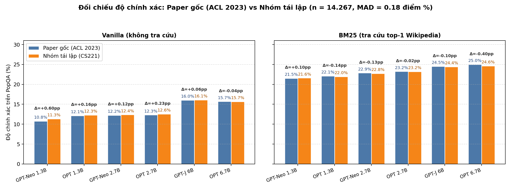
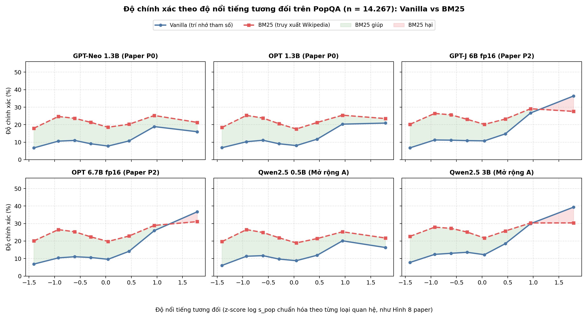

# Bảng tái lập

## Đối chiếu độ chính xác: Paper gốc (ACL 2023) vs Nhóm tái lập (issue #20, #25)

### Nguồn số liệu paper

Paper gốc ([Mallen et al., ACL 2023](https://aclanthology.org/2023.acl-long.546/)) trình bày kết quả tổng hợp dưới dạng biểu đồ vector (Hình 7, Hình 9, Hình 10, Hình 13), không in bảng số rời. Số liệu trong [`docs/paper_numbers.csv`](paper_numbers.csv) được trích trực tiếp từ tọa độ vector của file PDF chính thức (`2023.acl-long.546.pdf`, độ tuyến tính trục y sai số $< 10^{-10}$ pt; Hình 7 và Hình 13 khớp nhau đến 5 chữ số thập phân). Toàn bộ bảng đối chiếu và hình vẽ sinh bằng `python scripts/compare_paper_and_qwen.py` (kiểm bằng `python scripts/test_compare_paper_and_qwen.py`).

### Bảng so sánh 6 mô hình tái lập (đủ 14.267 câu PopQA)

| Mô hình | Kiểu số (Nhóm) | Vanilla: Paper → Nhóm ($\Delta$) | BM25: Paper → Nhóm ($\Delta$) | GenRead: Paper → Nhóm ($\Delta$) | Adaptive: Paper → Nhóm ($\Delta$) | Tỉ lệ tra cứu Adaptive: Paper → Nhóm |
|---|---|---|---|---|---|---|
| **GPT-Neo 1.3B** | fp32 | 10,75% → **11,35%** (+0,60pp) | 21,51% → **21,61%** (+0,10pp) | 11,90% → **11,65%** (-0,25pp) | — → **21,61%** | 94,0% → **94,9%** |
| **OPT 1.3B** | fp32 | 12,13% → **12,29%** (+0,16pp) | 22,10% → **21,96%** (-0,14pp) | 11,78% → **12,24%** (+0,46pp) | — → **22,04%** | — → **90,7%** |
| **GPT-Neo 2.7B** | fp32 | 12,25% → **12,37%** (+0,12pp) | 22,88% → **22,75%** (-0,13pp) | — | 23,31% → **23,27%** (-0,04pp) | 91,0% → **90,8%** |
| **OPT 2.7B** | fp32 | 12,33% → **12,56%** (+0,23pp) | 23,25% → **23,23%** (-0,02pp) | — | — → **23,79%** | — → **88,5%** |
| **GPT-J 6B** | fp16 | 16,03% → **16,09%** (+0,06pp) | 24,53% → **24,43%** (-0,10pp) | — | 25,55% → **25,56%** (+0,01pp) | 84,4% → **83,3%** |
| **OPT 6.7B** | fp16 | 15,70% → **15,66%** (-0,04pp) | 25,02% → **24,62%** (-0,40pp) | — | — → **25,79%** | — → **83,7%** |
| *Tham khảo (paper, không chạy lại)* | | | | | | |
| *OPT 13B* | *int8 (paper)* | *17,08%* | *25,41%* | *18,34%* | *—* | *—* |
| *GPT-NeoX 20B* | *int8 (paper)* | *19,86%* | *25,52%* | *—* | *28,14%* | *74,3%* |
| *GPT-3 davinci-003* | *API (đã ngừng)* | *34,00%* | *31,86%* | *39,14%* | *39,51%* | *45,0%* |

- **Độ khớp tái lập:** Trên toàn bộ **16 ô độ chính xác** so sánh trực tiếp được, sai lệch tuyệt đối trung bình (**MAD**) chỉ là **0,18 điểm %**, sai lệch lớn nhất chỉ **0,60 điểm %** (GPT-Neo 1.3B vanilla). Các nguyên nhân sai lệch nhỏ đã được kiểm chứng đầy đủ trong [`docs/KHAC_BIET.md`](KHAC_BIET.md): khác phiên bản PyTorch/Transformers (2026 vs 2023), sửa lỗi khóa tra đoạn văn cho 15 ví dụ mẫu (chứng minh qua đối chứng `results/code_goc/`: bản không kèm đoạn chỉ đạt 20,61% cho GPT-Neo 1.3B BM25, kém paper 0,90pp, trong khi bản kèm đoạn đạt 21,61%, khớp paper +0,10pp), ghép kết quả theo `id` thay vì `question`, và nạp `fp16` cho GPT-J 6B / OPT 6.7B để vừa VRAM T4 15 GB.
- **Đối chiếu thêm với con số ghi trong văn bản paper (Mục 4.2):** Trên 4.000 câu ít nổi tiếng nhất, paper báo GPT-J 6B đạt 15%–16%; kết quả tái lập của nhóm là **15,22%**.

### Kiểm chứng 4 kết luận của paper (trên 6 mô hình paper và 3 mô hình Qwen2.5)

Số liệu định lượng chi tiết cho cả 9 mô hình nằm ở [`results/tables/four_conclusions_check.csv`](../results/tables/four_conclusions_check.csv):

1. **Kết luận 1 — Thực thể càng nổi tiếng, mô hình càng hay trả lời đúng:** **ĐÚNG** trên cả 9/9 mô hình. Tương quan Pearson giữa $\log_{10}(\text{s\_pop})$ và độ đúng vanilla dương có ý nghĩa thống kê rất mạnh ở tất cả mô hình: từ $r = +0{,}088$ ($p = 6{,}4 \times 10^{-26}$, GPT-Neo 1.3B) đến $r = +0{,}231$ ($p = 2{,}7 \times 10^{-172}$, OPT 6.7B) và $r = +0{,}225$ ($p = 1{,}4 \times 10^{-163}$, Qwen2.5 3B). Nhóm 20% nổi tiếng nhất (`Q5`) vượt nhóm 20% ít nổi nhất (`Q1`) tới `+19,9` đến `+20,0` điểm % ở các mô hình lớn.
2. **Kết luận 2 — Mô hình to hơn chủ yếu giỏi hơn ở câu nổi tiếng (scaling ít cứu được long-tail):** **ĐÚNG** trên cả 3 họ mô hình. Kiểm định Difference-in-Differences giữa mức tăng ở `Q5` và `Q1`:
   - GPT-Neo 1.3B → GPT-J 6B: `Q1` tăng `+0,11pp` vs `Q5` tăng `+16,12pp` (DiD = `+16,02pp`, Welch $t = 16{,}80$, $p = 1{,}1 \times 10^{-61}$).
   - OPT 1.3B → OPT 6.7B: `Q1` giảm `-0,28pp` vs `Q5` tăng `+11,39pp` (DiD = `+11,67pp`, Welch $t = 13{,}36$, $p = 5{,}2 \times 10^{-40}$).
   - Qwen2.5 0.5B → Qwen2.5 3B: `Q1` tăng `+1,26pp` vs `Q5` tăng `+17,60pp` (DiD = `+16,34pp`, Welch $t = 17{,}71$, $p = 4{,}6 \times 10^{-68}$).
3. **Kết luận 3 — Retrieval giúp mạnh ở câu ít nổi tiếng, nhưng có thể gây hại ở câu nổi tiếng:** **ĐÚNG**. Trong nhóm `Q1` (ít nổi tiếng nhất), BM25 giúp tăng **+16,0 đến +20,4 điểm %** trên cả 9/9 mô hình (McNemar $p < 10^{-85}$). Ngược lại, trong nhóm `Q5` (nổi tiếng nhất), BM25 **gây hại có ý nghĩa thống kê** ở cả 4 mô hình mạnh nhất: GPT-J 6B (`-5,40pp`, $p = 1{,}3 \times 10^{-11}$), Qwen2.5 3B (`-5,15pp`, $p = 2{,}0 \times 10^{-11}$), OPT 6.7B (`-3,26pp`, $p = 4{,}2 \times 10^{-5}$), và Qwen2.5 1.5B (`-1,93pp`, $p = 8{,}1 \times 10^{-3}$).
4. **Kết luận 4 — Adaptive tốt bằng hoặc hơn cả hai cách, đồng thời giảm số lần tra cứu:** **ĐÚNG** (và nổi bật nhất ở mô hình mạnh). Trên 100 lần chia train/test 75/25 ghép cặp, Adaptive thắng BM25 ở **100/100 lần chia** (Wilcoxon $p < 4 \times 10^{-18}$) cho GPT-Neo 2.7B, GPT-J 6B (`+1,17pp`, giảm tra cứu còn 83,3%), OPT 6.7B (`+1,15pp`, 83,7%), Qwen2.5 1.5B (`+0,85pp`, 82,2%) và Qwen2.5 3B (`+1,29pp`, giảm tra cứu xuống **78,6%**). Với mô hình nhỏ nhất (GPT-Neo 1.3B), lợi ích gần bằng 0 (`-0,04pp`, tra cứu 94,9%), đúng như nhận định của paper ở Hình 9–10.

## Bảng 1 của paper, làm lại bằng BM25 (issue #29)

### Paper làm gì

Bảng 1 của paper (trang 7) chỉ xét GPT-3 `davinci-003` và Contriever trên PopQA. Mỗi câu hỏi rơi vào một trong 4 ô, tùy mô hình **không** tra cứu trả lời đúng hay sai, và mô hình **có** tra cứu trả lời đúng hay sai. Mỗi ô ghi tỉ lệ câu và recall@1 của Contriever. Số dưới đây đọc trực tiếp từ bảng, không phải số xấp xỉ từ biểu đồ.

| GPT-3 davinci-003 + Contriever (paper) | Có tra cứu đúng | Có tra cứu sai |
|---|---|---|
| Không tra cứu đúng | 24% (recall@1 0,83) | 10% (0,14) |
| Không tra cứu sai | 17% (0,88) | 49% (0,11) |

Paper rút ra: với 10% câu hỏi, tra cứu làm mô hình trả lời sai câu mà lẽ ra nó trả lời đúng, và recall@1 của các câu đó (0,14) thấp hơn nhiều so với recall@1 chung của Contriever (0,42). Với 17% câu hỏi, tra cứu cứu được một câu mô hình vốn sai, và recall@1 là 0,88.

### recall@1 là gì

recall@1 trả lời câu hỏi: "đoạn văn đứng đầu mà bộ tra cứu đưa cho mô hình có chứa đáp án không?". Với mỗi câu hỏi, bộ tra cứu (ở đây là BM25) chấm điểm cả kho đoạn văn Wikipedia và ta chỉ lấy **một** đoạn điểm cao nhất ("@1"). Nếu một đáp án trong `possible_answers` nằm trong đoạn đó thì câu hỏi tính là trúng. recall@1 của một nhóm câu là tỉ lệ câu trúng trong nhóm. Ví dụ: 100 câu mà 25 câu có đáp án trong đoạn top-1 thì recall@1 là 0,25.

Nó đo chất lượng của bộ tra cứu, không đo mô hình. Cho nên 9 mô hình dùng chung một đoạn top-1 cho mỗi câu, và recall@1 chung của BM25 giống nhau ở cả 9 mô hình: **25,54%**. Recall@1 chỉ khác nhau giữa các ô, vì mỗi ô gom những câu khác nhau.

### Cách làm

- 4 ô tính từ cột `is_correct` của lượt vanilla và lượt BM25, ghép theo `id`, đủ 14.267 câu, cho 9 mô hình. Chạy `python scripts/retrieval_help_hurt.py`, kết quả ở `results/tables/retrieval_help_hurt.csv`.
- recall@1 dùng cột `answer_in_passage` của `results/tables/bm25_top1_has_answer.csv`, dựng bằng `python scripts/make_bm25_top1_table.py --bm25 <file BM25>`. Quy tắc giống hệt cách chấm `is_correct` của code gốc: một đáp án xuất hiện trong đoạn văn, thử nguyên bản, chữ thường và viết hoa chữ đầu.
- Script kiểm `retrieval_id` của từng lượt BM25 trùng với bảng top-1, nên recall@1 nói về đúng đoạn văn mô hình đã thấy.
- Kiểm: `python scripts/test_retrieval_help_hurt.py`.

### Kết quả

Mỗi ô ghi: phần trăm câu (recall@1 của các câu trong ô).

| Mô hình | Vanilla đúng, BM25 đúng | Vanilla đúng, BM25 sai (hại) | Vanilla sai, BM25 đúng (giúp) | Vanilla sai, BM25 sai |
|---|---|---|---|---|
| GPT-Neo 1.3B | 9,1% (0,83) | 2,3% (0,30) | 12,6% (0,94) | 76,1% (0,07) |
| GPT-Neo 2.7B | 9,5% (0,83) | 2,9% (0,25) | 13,2% (0,94) | 74,4% (0,06) |
| OPT 1.3B | 9,5% (0,80) | 2,7% (0,34) | 12,4% (0,94) | 75,3% (0,07) |
| OPT 2.7B | 9,5% (0,77) | 3,1% (0,23) | 13,8% (0,94) | 73,7% (0,06) |
| OPT 6.7B (fp16) | 11,6% (0,75) | 4,0% (0,19) | 13,0% (0,93) | 71,4% (0,06) |
| GPT-J 6B (fp16) | 11,8% (0,77) | 4,3% (0,15) | 12,6% (0,94) | 71,3% (0,05) |
| Qwen2.5 0.5B | 9,5% (0,83) | 2,5% (0,27) | 13,1% (0,96) | 74,9% (0,06) |
| Qwen2.5 1.5B | 12,0% (0,78) | 4,0% (0,22) | 12,9% (0,96) | 71,1% (0,04) |
| Qwen2.5 3B | 13,9% (0,75) | 4,5% (0,12) | 12,5% (0,94) | 69,1% (0,04) |

### Đọc bảng

- **Ô "giúp" gần như không đổi theo cỡ mô hình:** 12,4% đến 13,8% số câu, recall@1 0,93 đến 0,96. Tra cứu cứu được những câu mà đoạn top-1 có đáp án; paper ghi 17% và 0,88.
- **Ô "hại" tăng theo độ mạnh của mô hình:** từ 2,3% (GPT-Neo 1.3B) đến 4,5% (Qwen2.5 3B); xếp 9 mô hình theo độ chính xác vanilla thì tỉ lệ này tăng gần đúng thứ tự (hệ số Spearman 0,98). Đó là 20,2% đến 26,7% số câu vanilla đang trả lời đúng bị BM25 làm sai, tức khoảng một phần năm đến hơn một phần tư. Paper ghi 10% với GPT-3, mô hình mạnh hơn nhiều.
- **Tăng ròng:** (giúp trừ hại) bằng đúng độ chính xác BM25 trừ vanilla, từ +8,1 đến +10,7 điểm. Bốn mô hình mạnh nhất (vanilla từ 15,6% trở lên) có phần tăng ròng nhỏ nhất, 8,1 đến 9,0 điểm; năm mô hình còn lại từ 9,7 đến 10,7 điểm. Lý do: phần "giúp" đứng yên còn phần "hại" lớn lên.
- **Ô "hại" và chất lượng đoạn văn:** paper giải thích ô này bằng đoạn văn kém (recall@1 0,14, thấp hơn nhiều recall@1 chung 0,42). Ở BM25, recall@1 của ô này thấp hơn recall@1 chung (0,2554) ở 5 mô hình: GPT-J 0,15, Qwen2.5 3B 0,12, OPT 6.7B 0,19, Qwen2.5 1.5B 0,22, OPT 2.7B 0,23. GPT-Neo 2.7B là 0,25, xấp xỉ mức chung. Ba mô hình yếu nhất (vanilla dưới 12,3%) lại cao hơn: Qwen2.5 0.5B 0,27, GPT-Neo 1.3B 0,30, OPT 1.3B 0,34. Vậy lời giải thích "đoạn văn kém làm mô hình sai" khớp với các mô hình mạnh hơn, còn ở ba mô hình yếu nhất thì chưa thấy rõ; chưa có thí nghiệm riêng để biết vì sao.
- **Ô "sai cả hai" chiếm 69% đến 76% và recall@1 chỉ 0,04 đến 0,07:** phần lớn câu mô hình vẫn sai là vì đoạn top-1 không chứa đáp án (recall@1 chung chỉ 25,54%).
- **Ô "đúng cả hai":** 9,1% đến 13,9%, recall@1 0,75 đến 0,83 (paper 24% và 0,83).

Liên hệ 4 kết luận: bảng này cho phần "retrieval có thể hại" của kết luận 3 (2,3% đến 4,5% câu bị hại, tăng theo độ mạnh của mô hình). Phần "giúp câu ít nổi tiếng, hại câu nổi tiếng" theo độ nổi tiếng nằm ở `docs/BANG_MO_RONG.md` (bảng nhóm điểm: nhóm nổi tiếng nhất bị hại ở OPT 6.7B, GPT-J 6B, Qwen2.5 1.5B và 3B) và sẽ làm đầy đủ ở issue #25.

### So với paper, khác gì

- **Mô hình khác:** paper làm bảng này với GPT-3 `davinci-003`, mạnh hơn mọi mô hình của nhóm (không chạy lại được, OpenAI đã ngừng). Vì vậy phần trăm các ô không so thẳng được, nhất là ô "đúng cả hai" (paper 24%).
- **Bộ tra cứu khác:** paper dùng Contriever (recall@1 chung 0,42); nhóm dùng BM25 (0,2554) vì tác giả mất file kết quả Contriever (`docs/KE_HOACH.md`). Recall@1 thấp hơn kéo ô "sai cả hai" lên (69% đến 76%, paper 49%).
- Cái so được là **hình dạng**: ô "giúp" có recall@1 rất cao (0,93 đến 0,96, paper 0,88), ô "hại" có recall@1 thấp ở các mô hình mạnh hơn (như paper, 0,14), ô "sai cả hai" có recall@1 thấp nhất.

### Lưu ý: cờ `has_answer` có sẵn đánh giá thiếu recall@1

File BM25 của tác giả có cờ `hasanswer` cho từng đoạn, và cột `has_answer` trong `results/slim/` là cờ đó. Dùng cờ thì recall@1 chung chỉ là **7,86%**; tính lại bằng quy tắc chấm của đồ án ra **25,54%**. Trong 14.267 câu, cờ báo "có đáp án" cho 1.122 câu, tính lại cho 3.644 câu; 1.116 câu trùng, chỉ 6 câu cờ báo mà tính lại không thấy, còn 2.528 câu cờ bỏ sót. Ở ô "giúp", recall@1 theo cờ là 0,21 đến 0,23, còn theo cách tính lại là 0,93 đến 0,96. Chưa rõ cờ được tính bằng cách nào (có thể chặt hơn về cách so chuỗi). Vì vậy bảng trên không dùng cờ; ghi ở dòng 12 của `docs/KHAC_BIET.md`.

### Giới hạn

- Chỉ đoạn top-1 (như paper và code gốc). Đáp án có thể nằm ở đoạn thứ 2 đến thứ 5 mà không tính.
- recall@1 dùng so khớp chuỗi con như cách chấm `is_correct`, nên có dương tính giả với đáp án ngắn (ví dụ đáp án "red" nằm trong chữ "retired", "US" nằm trong "multi-use", xem `docs/PHAN_TICH.md` mục 3); số recall@1 vì vậy hơi cao.
- recall@1 chỉ cho biết đáp án có nằm trong đoạn, không cho biết đoạn có nói về đúng thực thể. Khi hai người trùng tên, đoạn có thể chứa đáp án của người khác (xem PopQA có 881 câu hỏi trùng văn bản).
- Ô "hại" chỉ có 2,3% đến 4,5% số câu (khoảng 330 đến 640 câu mỗi mô hình), nên recall@1 của ô này dao động nhiều hơn các ô lớn.
- Bảng 2×2 gộp mọi loại quan hệ và mọi mức nổi tiếng; chia theo nổi tiếng và theo loại quan hệ là việc của #25, #36.
